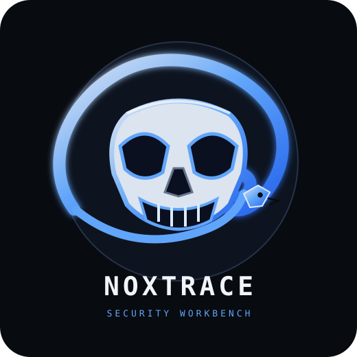
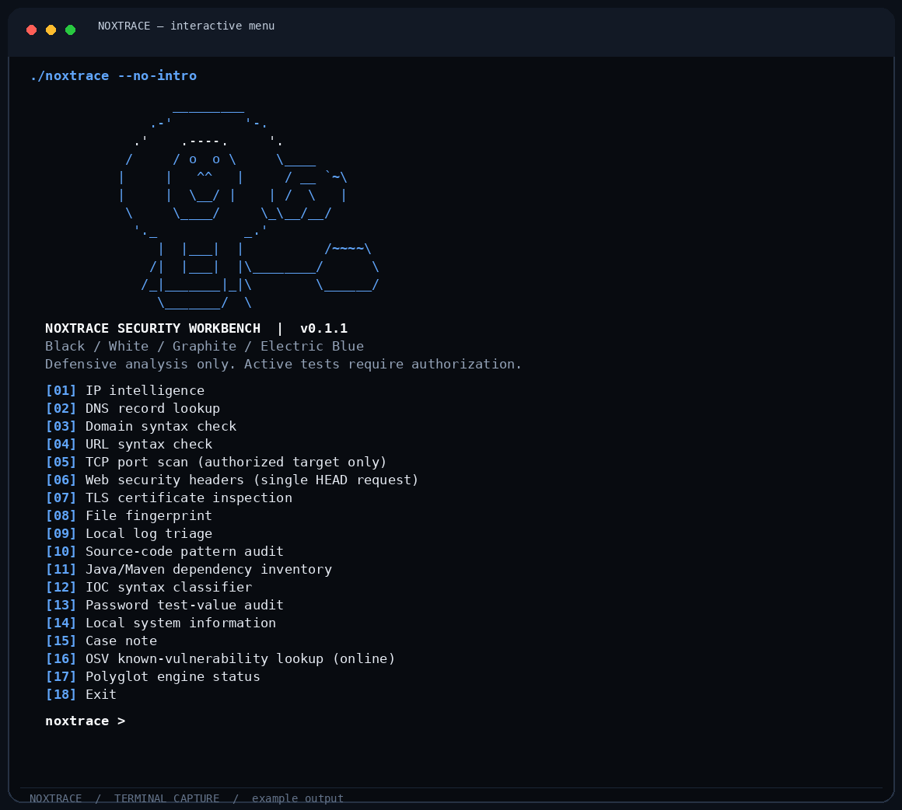
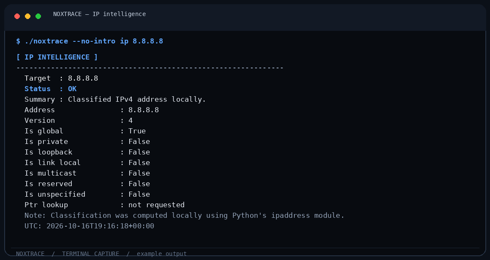
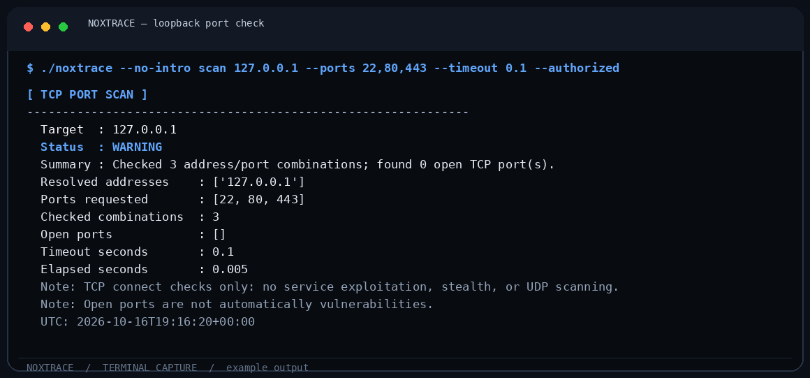

<div align="center">
  
  <br />
  
  <h1>NOXTRACE</h1>
  <p><strong>One command. Multiple engines. A clearer security picture.</strong></p>
  <p>A dark, modular security workbench for authorized network assessment, web configuration reviews, local forensics, and structured reporting.</p>
  <p>
    
    
    
    <a href="https://github.com/raxwqx/NOXTRACE/actions/workflows/tests.yml"></a>
  </p>
  <p><code>Python · Go · Rust · C · Java · Bash</code></p>
  <p><a href="README.md">🇹🇷 Türkçe kullanım kılavuzu</a></p>
  <p><a href="#-features">Features</a> · <a href="#-installation">Installation</a> · <a href="#-commands">Commands</a> · <a href="#-polyglot-engines">Polyglot engines</a> · <a href="#-security-boundaries">Security boundaries</a></p>
</div>

---

## 🌑 What is NOXTRACE?

**NOXTRACE** is an original, extensible command-line workbench. Its Python CLI acts as the entry point, while optional Go, Rust, C, Java, and Bash engines handle specialized jobs. The interface uses a graphite-black palette, white/gray text, and electric-blue accents.

The goal is not to promise that one tool can find every vulnerability. It is to provide **useful, testable modules that explain what they checked, what they found, and what they did not do**.

> [!IMPORTANT]
> Use active network checks only against systems you own or have explicit permission to assess. NOXTRACE does not include DDoS functionality, stealth/evasion features, credential attacks, exploit delivery, or automated vulnerability exploitation.

## ✨ Features

| Module | What it actually does | Network activity |
|---|---|---|
| 🧭 **IP Intelligence** | Classifies IPv4/IPv6 addresses: global, private, loopback, link-local, multicast, reserved and unspecified. Optional PTR lookup. | Local analysis; PTR only when requested. |
| 🗺️ **DNS Intelligence** | A/AAAA through the configured resolver. Optional MX/NS/TXT/CNAME lookups through `dnspython`. | DNS queries to configured resolver. |
| 🎯 **Bounded TCP Scan** | TCP connect checks for up to 256 selected ports, with timeouts and a concurrency cap. | Active connections; explicit `--authorized` required. |
| 🛡️ **Web Header Audit** | One HTTP `HEAD` request; checks common security headers and cookie flags. Does not follow redirects or send attack payloads. | One request; explicit authorization required. |
| 🔒 **TLS Inspection** | Validates the peer certificate against the local trust store and reports the negotiated TLS version/cipher. | One TLS handshake; explicit authorization required. |
| 🔗 **URL Inspector** | Parses URL structure and flags basic syntax concerns without opening the URL. | None. |
| 🏷️ **Domain Validator** | Normalizes IDN hostnames and validates syntax offline. | None. |
| #️⃣ **File Fingerprinting** | Computes SHA-256, SHA-512 and BLAKE2b locally. | None; file is not changed or uploaded. |
| 🧾 **Log Triage** | Checks local logs for a small set of review-worthy patterns; outputs line numbers/rule names, not entire matching lines. | None. |
| 🧪 **Source Code Audit** | Reviews common source files for risky patterns such as dynamic evaluation, disabled TLS validation, unsafe deserialization, shell invocation and DOM injection sinks. | None; files stay local. |
| 🧯 **OSV Package Check** | Looks up a selected package/version in the public OSV vulnerability database when you explicitly opt in. | Sends package name/version/ecosystem to OSV.dev; `--online` is required. |
| ☕ **Java/Maven Review** | Reads a local `pom.xml`, inventories dependency coordinates, and flags versions for manual review. | None; not a CVE database scan. |
| 🧩 **IOC Classifier** | Categorizes an IP, domain, URL or hash-shaped value offline. | None; no reputation API. |
| 🔑 **Password Test-Value Audit** | Estimates length and character diversity locally without retaining or printing the supplied value. | None. Use a test phrase, never a reused real password. |
| 🗒️ **Case Notes** | Structures analyst-authored observations for JSON/HTML export. | None. |
| 📑 **Reporting** | Human-readable terminal output, JSON export and standalone styled HTML reports. | Local file output. |
| 🧰 **Polyglot engines** | Optional Go TCP scanner, Rust classic-PCAP inventory, C system snapshot, Java Maven inventory, Bash lab readiness check. | Depends on selected engine; PCAP/system checks are local-only. |

A missing header, open port, old dependency pattern, or syntax flag is **not automatically a confirmed vulnerability**. Results are review leads, not a substitute for expert validation.

## 🖥️ Terminal screenshots

### Animated startup

The GIF above previews the original startup artwork. In the actual CLI, a bundled ANSI-frame animation plays before the menu; no image viewer, network connection or image library is required.

### Interactive menu



### IP intelligence output



### Bounded TCP check on the local loopback interface



<sub>These images were rendered from real CLI command output. Results are examples from one run and may differ on another machine. The port-check example targets only <code>127.0.0.1</code>.</sub>

## 📦 Requirements

- Python **3.10+** for the core tool.
- Git is recommended for cloning.
- No required Python runtime dependencies for the core CLI.
- Optional: `dnspython` for MX/NS/TXT/CNAME records.
- Optional online check: access to OSV.dev for `osv-check`.
- Optional compilers/runtimes for extra engines: Go, Rust/Cargo, a C compiler, Java 11+, and Bash.

## 🚀 Installation

### Option A: Download ZIP

1. Open the repository page and select **Code → Download ZIP**.
2. Extract it and open a terminal inside the `NOXTRACE` folder.
3. Run the launcher:

```bash
chmod +x ./noxtrace
./noxtrace
```

The launcher runs directly from source. It does not need a virtual environment to start the core CLI. In an interactive terminal, a short bundled animation plays before the menu; no image viewer, network connection, or image library is required. Use `./noxtrace --no-intro` to skip it.

### Option B: Install the command name

From the project root:

```bash
./install.sh
noxtrace
```

Use `noxtrace --no-intro` to skip the animated startup splash, or set `NOXTRACE_NO_INTRO=1` for a one-session opt-out. The standalone GIF preview is in `assets/noxtrace-intro.gif`; the terminal animation uses pre-rendered ANSI frames so Pillow is not required at runtime.

The installer creates a lightweight launcher at `~/.local/bin/noxtrace`. The core tool needs no pip install and no virtual environment. If your shell says `command not found`, add `export PATH="$HOME/.local/bin:$PATH"` to `~/.zshrc` and open a new terminal. From inside the project, `./noxtrace` always works too.

For optional full DNS record support:

```bash
./install.sh --dns
noxtrace dns example.com --types A AAAA MX NS TXT CNAME
```

The `--dns` option needs internet access to install `dnspython` into a project-local virtual environment. The generated launcher automatically uses that environment. The core installation has no required third-party runtime dependencies.

### Option C: Clone with Git

```bash
mkdir -p ~/projeler
cd ~/projeler
git clone https://github.com/raxwqx/NOXTRACE.git
cd NOXTRACE
./install.sh
noxtrace
```

## 🧭 Commands

### IP and DNS

```bash
# Local classification only
noxtrace ip 8.8.8.8

# Explicitly request reverse DNS/PTR resolution
noxtrace ip 8.8.8.8 --ptr

# A/AAAA records with the standard library resolver
noxtrace dns example.com --types A AAAA

# MX, NS, TXT and CNAME require the optional DNS extra
noxtrace dns example.com --types MX NS TXT CNAME

# Offline domain syntax validation
noxtrace domain example.com
```

### Authorized TCP port checks

```bash
# Bounded list on your own lab host or an explicitly authorized target
noxtrace scan 127.0.0.1 --ports 22,80,443,8000-8010 --authorized

# Shorten the timeout for a local test
noxtrace scan 127.0.0.1 --ports 22,80,443 --timeout 0.2 --authorized
```

Only TCP connect checks are implemented. A single request is not a full service fingerprint or a proof of vulnerability. The tool rejects more than 256 unique ports per run and caps concurrency at 32 workers.

### Web and TLS checks

```bash
# One HEAD request, no redirect following, no payload injection
noxtrace web-audit https://example.com --authorized

# TLS certificate validation and negotiated parameters
noxtrace tls example.com --port 443 --authorized
```

These commands may connect to the target. `--authorized` is a deliberate confirmation that you control the system or have permission to test it. Web checks can report missing headers as review hints, not confirmed exploits.

### Files, logs, Maven, and indicators

```bash
# Local file fingerprint
noxtrace hash ./sample.bin

# Local log triage; output avoids copying full log lines
noxtrace log /var/log/auth.log

# Offline static pattern scan of your own source directory
noxtrace code-audit ./src

# Offline Java/Maven dependency inventory
noxtrace pom-audit ./pom.xml

# Query known open-source package advisories (explicitly sends package metadata online)
noxtrace osv-check requests 2.31.0 --ecosystem PyPI --online
# Sends only the package name, version, and ecosystem to OSV.dev.
# API details: https://google.github.io/osv.dev/post-v1-query/

# Offline IP/domain/URL/hash-shaped indicator classification
noxtrace ioc 8.8.8.8

# Use a TEST phrase, not a real/reused password
noxtrace password-audit
# A hidden prompt appears; the supplied value is not printed or stored in the report.

# A structured analyst note
noxtrace case-note lab-01 'Expected test service was reachable'
```

### JSON and HTML reports

Most analysis commands support both machine-readable JSON and a local HTML report:

```bash
mkdir -p reports
noxtrace ip 8.8.8.8 --json
noxtrace dns example.com --types A AAAA --output reports/dns.json
noxtrace web-audit https://example.com --authorized --html reports/web-audit.html
```

Review reports before sharing. They can include target hostnames, local metadata, file paths, or text you supplied.

## 🧬 Polyglot engines

The Python CLI is the stable entry point. Other languages are optional companions with independent tasks, not labels added for decoration.

| Language | Engine | Build/run |
|---|---|---|
| Python | Main CLI, reporting, DNS/IP/web/local analysis | `./noxtrace` or `noxtrace` |
| Go | Bounded TCP connect scanner | `noxtrace engine go-scan 127.0.0.1 22,80,443 --authorized` |
| Rust | Offline classic-PCAP metadata inventory (not PCAPNG) | `noxtrace engine rust-pcap examples/empty.pcap` |
| C | Local OS/hostname/architecture/effective-UID snapshot | `noxtrace engine c-system` |
| Java | Offline Maven `pom.xml` inventory with XML external entities disabled | `noxtrace engine java-pom ./pom.xml` |
| Bash | Local toolchain readiness check; makes no network requests | `noxtrace engine bash-check` |

Inspect what's available on your machine:

```bash
noxtrace engines
noxtrace engine bash-check
```

Go and C binaries are built on demand when their engine command is run. Rust compiles through Cargo when requested. Java uses source-file mode and therefore works best with a JDK 11 or newer. Missing optional toolchains do not prevent the Python CLI from working.

## 🧪 Tests and development

Run from the repository root:

```bash
python3 -m compileall -q src tests
python3 -m unittest discover -s tests -v
```

If Go, C, and Java are installed, test those sources too:

```bash
(cd engines/go && go test ./...)
cc -std=c11 -O2 -Wall -Wextra -Werror engines/c/system_audit.c -o /tmp/noxtrace-c-test
java engines/java/NoxtracePomAudit.java examples/pom-sample.xml
```

GitHub Actions runs Python compilation and unit tests on the configured Python matrix. Rust code is dependency-free, but building the optional engine requires Rust/Cargo on the user's system.

## 🔒 Security boundaries and privacy

- Use active checks only on systems you own or are explicitly authorized to assess.
- No DDoS, stress flooding, stealth/evasion, credential guessing, exploit payloads, or automated exploitation are included.
- TCP scanning is limited to a maximum of 256 unique ports and 32 workers.
- The web module sends a single `HEAD` request, does not follow redirects and does not inject payloads.
- TLS validation uses the local trust store. Certificate failures are reported rather than silently bypassed.
- DNS queries use the configured resolver. IP/domain/URL syntax checks and file hashes are local.
- Log triage returns matching line numbers/rule names rather than full matching content.
- Password audit accepts only a local test value and deliberately never stores/prints the supplied secret. Prefer a made-up phrase.
- Remove tokens, passwords, private details, and sensitive file paths before sharing reports.
- Heuristic output requires human validation. OSV checks query published upstream records but do not prove runtime exploitability. This project does not claim complete vulnerability detection.

Read [SECURITY.md](SECURITY.md) and [docs/methodology.md](docs/methodology.md) before using active checks.

## 🗺️ Project structure

```text
NOXTRACE/
├── assets/noxtrace.svg
├── assets/noxtrace-intro.gif  # Original animated startup artwork
├── assets/screenshots/       # CLI output captures shown in this README
├── docs/                  # Methodology, operations, and scope rules
├── engines/
│   ├── bash/              # Local lab readiness script
│   ├── c/                 # Local system snapshot
│   ├── go/                # Bounded TCP scanner
│   ├── java/              # Maven dependency inventory
│   └── rust/              # Offline classic-PCAP inventory
├── examples/              # Harmless log/POM fixtures and a zero-packet classic PCAP
├── scripts/               # Installation and checks
├── src/noxtrace/          # Python CLI and modular analyzers
│   ├── intro.py           # Offline animated terminal splash player
│   ├── intro_frames.ansi  # Pre-rendered frames (no Pillow needed at runtime)
│   └── modules/           # IP, DNS, ports, web, TLS, code, logs, hashes, etc.
├── tests/                 # Offline unit tests
├── install.sh
├── noxtrace               # Project-local executable launcher
├── pyproject.toml
├── SECURITY.md
└── README.md
```

## 🤝 Contributing

Small, testable modules are preferred. A new module should document its network behavior, scope limits, data collected, failure modes, and tests. See [CONTRIBUTING.md](CONTRIBUTING.md).

## 📜 License

MIT. See [LICENSE](LICENSE).

<div align="center">
  <strong>NOXTRACE</strong><br />
  <sub>Know what was checked. Know what was not. 🖤🔵</sub>
</div>
